# KostGo

Aplikasi mobile untuk mencari kost, dibuat dengan Expo dan React Native. Ini tugas kelompok kuliah.

## Fitur

**Untuk pengguna**

- **Login dan daftar**: masuk dengan akun, atau buat akun baru. Admin masuk ke Dashboard, pengguna biasa masuk ke aplikasi.
- **Home**: cari kost, pilih kategori (Putri, Putra, Campur), dan lihat daftar kost.
- **Explore**: cari berdasarkan nama atau lokasi, lalu filter menurut kategori.
- **Detail kost**: deskripsi, fasilitas, galeri, harga per bulan, tombol favorit, dan tombol Book Now.
- **Map**: tampilan peta sederhana dengan pin kost dan daftar kost terdekat.
- **Favorit dan Booking**: kost yang disimpan dan dibooking tampil di halaman masing-masing.
- **Profil**: nama dan email akun yang sedang login, menu menuju My Favorites dan My Booking, serta Log Out.
- **Tombol back Android**: kembali ke tab sebelumnya. Di Home, tekan dua kali untuk keluar.

**Untuk admin**

- **Dashboard**: ringkasan jumlah kost, booking, favorit, rata-rata rating dan harga, serta jumlah kost per kategori.
- **Kelola kost**: tambah, ubah, dan hapus kost. Perubahan langsung tampil di Home, Explore, Map, dan Detail.

## Akun untuk mencoba

| Peran | Email | Password |
| --- | --- | --- |
| Admin | `admin@kostgo.com` | `kostgo123` |
| Pengguna | `user@kostgo.com` | `user123` |

Akun baru bisa dibuat lewat menu Daftar di halaman Login. Akun baru selalu berperan sebagai pengguna.

## Tampilan

Gambar ada di folder `docs/screenshots`.

| Login | Daftar | Home |
| --- | --- | --- |
| 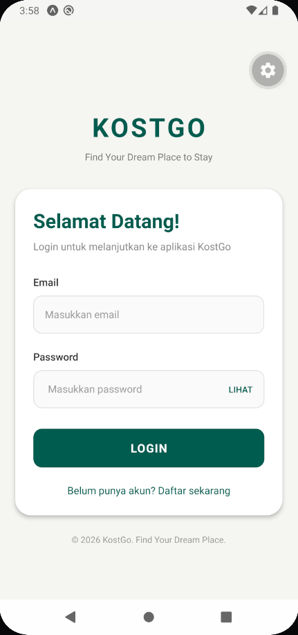 | 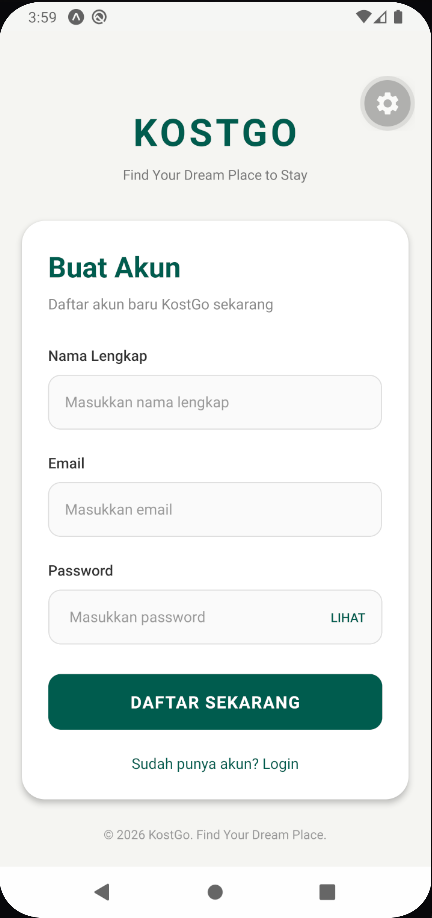 | 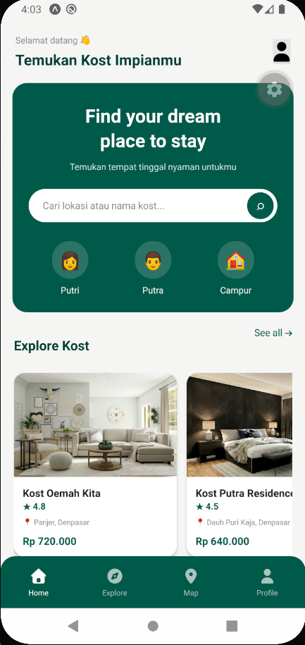 |

| Explore | Detail | Map |
| --- | --- | --- |
| 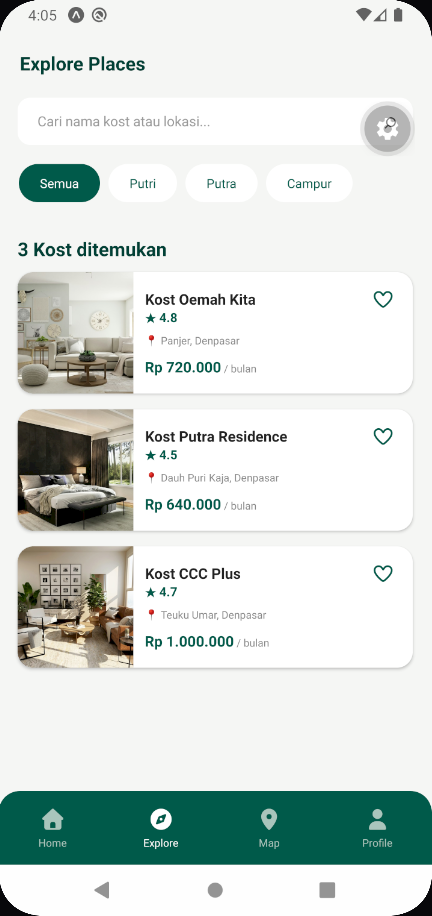 | 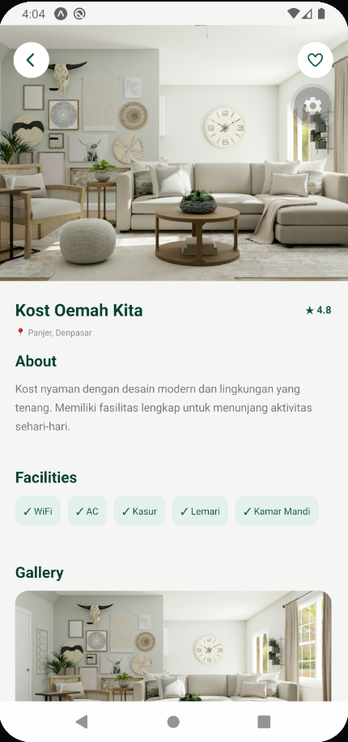 | 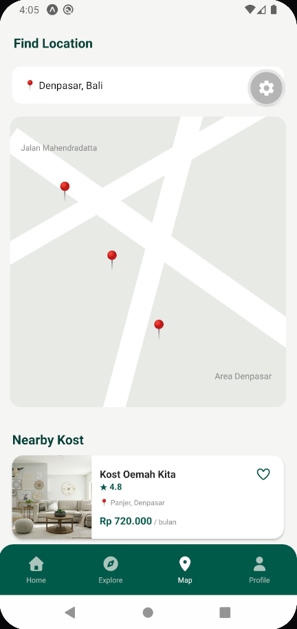 |

| Profil | Favorit | Booking |
| --- | --- | --- |
| 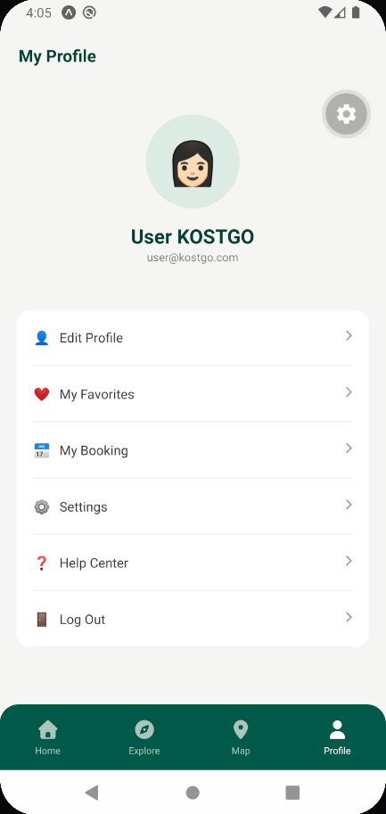 | 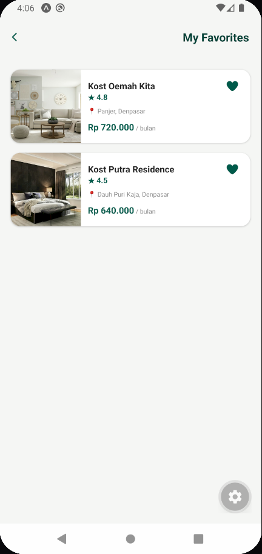 | 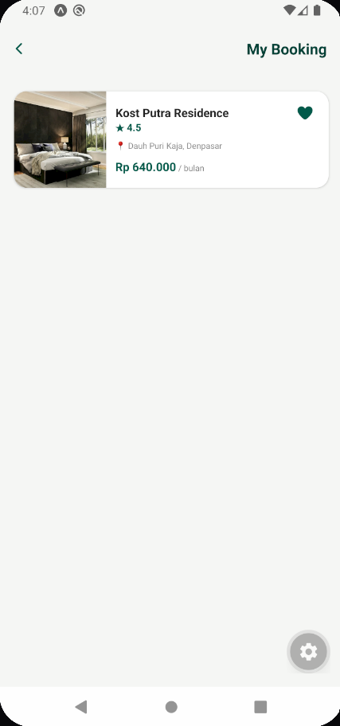 |

| Dashboard admin | Form kost |
| --- | --- |
| 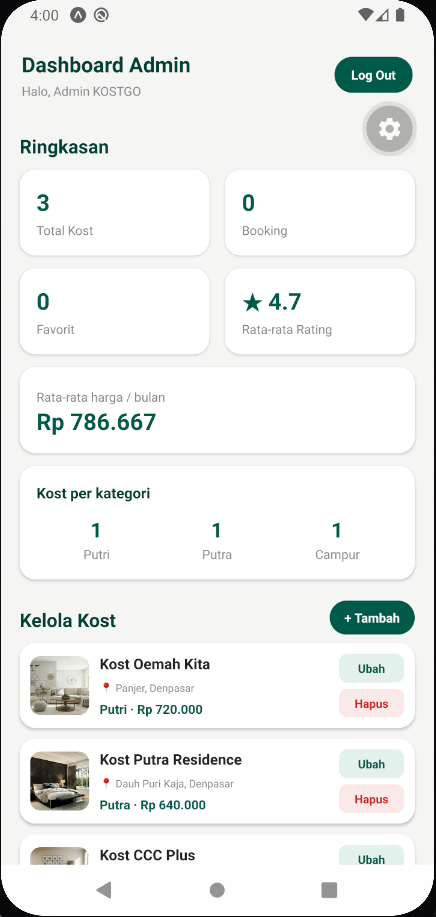 | 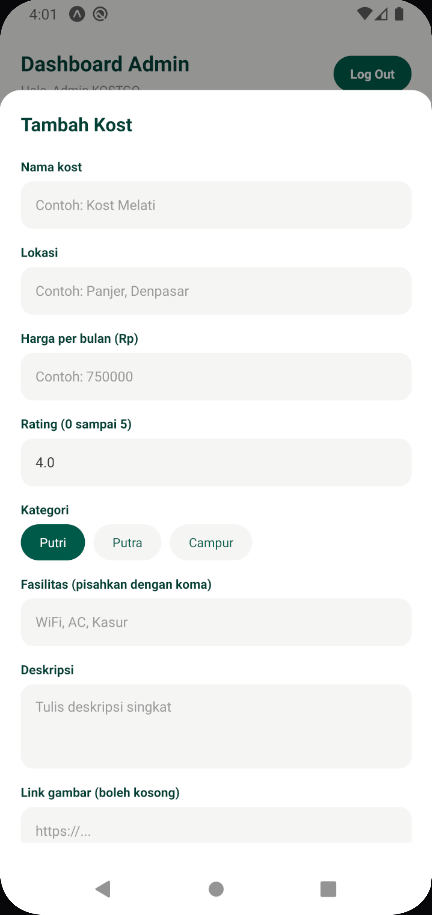 |

## Teknologi

- Expo SDK 58 dan React Native 0.88 (React 19)
- React Navigation 7 (bottom tabs dan native stack)
- Font Awesome untuk ikon
- JavaScript

## Cara menjalankan

Butuh Node.js dan emulator Android (atau HP dengan Expo Go).

```bash
npm install
npm start
```

Setelah server jalan, tekan `a` untuk Android atau scan kode QR dengan Expo Go. Bisa juga langsung:

```bash
npm run android
```

## Struktur folder

```
App.js                 pasang provider dan navigator
index.js               titik masuk aplikasi
docs/screenshots/      gambar tampilan untuk README
src/
  core/                dipakai bersama oleh semua layar
    components/        Header, KostCard, BottomBar, HeartIcon, KeyboardScrollView
    data/              data kost dan akun (dummy)
    hooks/             useOpenKost, useLogout
    state/             AppContext (pencarian, filter, favorit, booking, kost, akun)
    styles/            style yang dipakai banyak layar
    utils/             format harga
    theme.js           warna
  navigation/          tab bawah, stack, dan penanganan tombol back
  screens/             layar aplikasi (tiap layar punya file .styles.js)
```

Style dipisah per layar dan per komponen: file `Nama.js` berisi tampilan, file `Nama.styles.js` berisi style-nya.

## Alur kode

1. `index.js` memuat `App.js`.
2. `App.js` memasang `AppProvider` (state bersama) dan `RootNavigator`.
3. `RootNavigator` dimulai dari layar Login. Setelah login, admin dibawa ke `AdminDashboard` dan pengguna biasa ke `MainTabs` (Home, Explore, Map, Profile). Layar Detail, Favorites, dan Bookings dibuka di atas tab.
4. Layar membaca dan mengubah state lewat `useApp()`, jadi semua layar memakai data yang sama. Daftar kost juga ada di state ini, jadi perubahan dari Dashboard langsung terlihat di layar lain.
5. Kartu kost membuka Detail lewat `useOpenKost`, yang mengirim `kostId` ke layar Detail.
6. Log Out memakai `useLogout`: menghapus akun yang login, lalu kembali ke Login dan mengosongkan riwayat halaman.

## Pembagian kerja

| Bagian | Dikerjakan oleh |
| --- | --- |
| Login/Register | Cynthya |
| Home | Cynthya |
| Explore | Cynthya |
| Detail | Adi |
| Map | Adi |
| Profile (termasuk Favorites & Bookings) | Adi |
| Dashboard admin dan form kost | Adi |
| Struktur bersama (`core`, `navigation`) | Adi |

## Keterbatasan

- Data kost dan akun ada di memori (`src/core/data`). Kost yang ditambah, akun baru, favorit, dan booking hilang saat aplikasi ditutup.
- Password disimpan apa adanya, tanpa enkripsi. Ini hanya untuk keperluan tugas.
- Map masih gambar sederhana, bukan peta sungguhan.
- Menu Edit Profile, Settings, dan Help Center belum aktif.

## Lisensi

MIT, lihat file [LICENSE](LICENSE).
